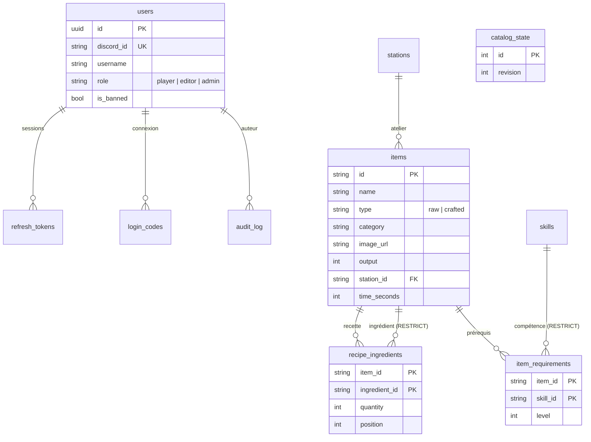

# Syncron 4 — Architecture

## 1. Vue d'ensemble

Trois paquets Python dans un même dépôt, avec une seule règle de dépendance : **`syncron_core` ne dépend de rien**, et le serveur comme le client dépendent de lui.

```
syncron_core      modèles, moteur de calcul, validation, format JSON, exports      (Python pur)
   ▲        ▲
   │        └──── syncron_server   FastAPI · SQLAlchemy 2 async · PostgreSQL · Alembic · Discord OAuth2
   └───────────── syncron_client   PySide6 · httpx · keyring · cache disque
```

Le **même code** valide le catalogue côté serveur, avant chaque écriture, et calcule les crafts côté client. Un plan de fabrication est donc identique partout, y compris hors ligne.

## 2. Serveur

### Base de données (PostgreSQL)



- Le catalogue est **normalisé** et protégé par des clés étrangères (`RESTRICT` sur les ingrédients, ateliers et compétences référencés) et par des contraintes `CHECK` (types, quantités ≥ 1, une ressource primaire n'a pas de champs de recette, un objet n'est pas son propre ingrédient).
- `catalog_state.revision` augmente à chaque écriture. Elle sert d'**ETag** au client et de **verrou** (`SELECT … FOR UPDATE`) pour sérialiser les écritures.

### Écriture du catalogue : un seul chemin

```
verrou(catalog_state) → catalogue courant (CraftData) → catalogue cible (fonction pure)
→ RecipeValidator + longueurs → refus 422 avec la liste des problèmes
→ différentiel → INSERT/UPDATE/DELETE → révision + 1 → journal → COMMIT
```

Ce chemin unique sert aussi bien pour un objet, un atelier, une image ou un import de 1 000 objets. Le catalogue enregistré est donc **toujours cohérent** : pas de référence orpheline, pas de cycle, pas de niveau au-delà du maximum.

### Authentification

1. Le client ouvre `GET /api/v1/auth/discord/start?redirect_uri=http://127.0.0.1:<port>/callback&state&code_challenge`.
2. L'API signe un état (JWT de 10 minutes) et redirige vers Discord.
3. Discord rappelle `/api/v1/auth/discord/callback`. L'API échange le code (le secret Discord ne quitte jamais le serveur), lit le profil, vérifie l'appartenance au serveur Discord si c'est exigé, puis crée ou met à jour l'utilisateur.
4. L'API renvoie le navigateur sur `127.0.0.1` avec un **code à usage unique** de 2 minutes.
5. Le client échange ce code et son `code_verifier` (**PKCE S256**) contre :
   - un **jeton d'accès** JWT de 15 minutes ;
   - un **jeton de rafraîchissement** opaque de 30 jours, **haché** en base et **rotatif** : la réutilisation d'un jeton déjà échangé révoque toutes les sessions du compte.

### Endpoints

| Méthode | Route | Accès |
|---|---|---|
| GET | `/health`, `/api/v1/meta` | public |
| GET | `/api/v1/auth/discord/start`, `/callback` | public |
| POST | `/api/v1/auth/token`, `/refresh`, `/logout` | public (jetons) |
| GET | `/api/v1/auth/me` | connecté |
| GET | `/api/v1/catalog` (ETag, 304) | connecté |
| POST | `/api/v1/craft/plan` | connecté |
| GET | `/api/v1/admin/dashboard`, `/audit`, `/export` | éditeur |
| PUT, DELETE | `/api/v1/admin/{items,stations,skills}/{id}` | éditeur |
| PUT, DELETE | `/api/v1/admin/{items,stations}/{id}/image` | éditeur |
| POST | `/api/v1/admin/import?mode=merge&dry_run=` | éditeur (`replace` : admin) |
| GET, PATCH | `/api/v1/admin/users` | admin |
| GET | `/media/…` | public, cache immuable |

Les images sont vérifiées et converties en PNG (512 px maximum, 2 Mo maximum). Elles sont nommées par empreinte : une image modifiée a une nouvelle URL, ce qui permet un cache infini côté Caddy et côté client.

## 3. Client

```
Launcher ──▶ LoginWindow ──(Discord / reprise / hors ligne)──▶ ShellWindow
   │                                                            │
   ├─ ApiClient (httpx, renouvellement automatique des jetons)  ├─ Accueil · Paramètres
   ├─ TokenStore (coffre du système, ou fichier en repli)       ├─ Craft
   ├─ CatalogStore (cache disque, ETag, images)                 ├─ Calendrier, R&D (annoncés)
   ├─ Session (utilisateur, rôle, en ligne)                     └─ Administration (éditeur+)
   └─ TaskRunner (QThreadPool → retour dans le thread de l'interface)
```

- **Aucun appel réseau dans le thread de l'interface** : `TaskRunner` exécute les appels dans le pool de Qt et rappelle le résultat dans le thread de l'interface.
- Un outil déclare `ToolInfo.min_role`. La plateforme ne charge l'outil que pour les comptes qui ont ce rôle, et le place dans la section « Gestion ». Le serveur, de son côté, revérifie chaque droit.
- **Hors ligne** : si le serveur est injoignable et qu'un catalogue est en cache, l'application s'ouvre en lecture seule, avec une pastille « Hors ligne · Réessayer ».
- **Version minimale** : `/meta.min_client_version` permet de bloquer les clients trop anciens avec un message de mise à jour.

## 4. Mode admin

| Onglet | Contenu |
|---|---|
| Tableau de bord | compteurs, éléments « à compléter » (sans image, sans temps, sans catégorie), activité récente |
| Objets | liste et fiche : type, catégorie, image, atelier, temps (`1h30`…), rendement, ingrédients, prérequis |
| Ateliers / Compétences | fiches et usage (« utilisé par… ») ; une suppression bloquée est expliquée |
| Comptes (admin) | rôle, suspension, recherche |
| Journal | qui a modifié quoi et quand, chargement progressif |
| Import / export | export JSON ; import en fusion ou en remplacement, avec analyse avant application |

## 5. Ajouter un outil

1. Créer `src/syncron_client/tools/<outil>/` avec une sous-classe de `Tool`. Elle reçoit `ToolHost` : `api`, `session`, `runner`, `catalog`, `notify`, `handle_error`.
2. Si l'outil a besoin de nouvelles données :
   - modèle et migration Alembic dans `syncron_server` ;
   - routes dans `syncron_server/routers/` ;
   - méthodes dans `ApiClient`.
3. L'ajouter à `builtin_tools()`.

Calendrier et R&D sont déjà annoncés (`PlannedTool`). Ils suivront ce schéma.

## 6. Tests

| Suite | Ce qui est vérifié |
|---|---|
| `tests/core` | calcul (arrondis fusionnés, temps, ateliers, prérequis, stock), format JSON, validation |
| `tests/server` | sur **PostgreSQL réel** : parcours Discord complet (PKCE, loopback, serveur obligatoire, refus), rotation des jetons et détection de vol, droits par rôle, écritures refusées (références, niveaux, cycles), suppressions expliquées, images, import / export, comptes, tableau de bord |
| `tests/client` | contre un **vrai serveur uvicorn** : connexion de développement et Discord par la boucle locale, synchronisation, Craft, éditeurs admin, images jusqu'au cache, comptes, journal, export, déconnexion et reprise, mode hors ligne, version minimale, threads |
