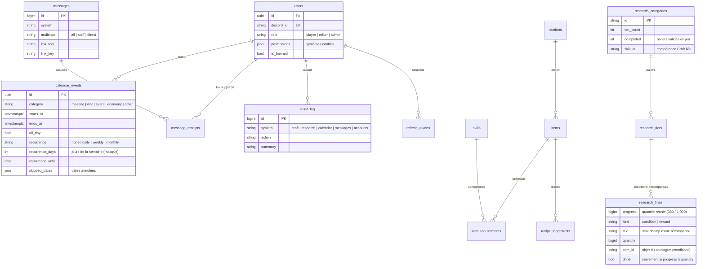

# Syncron 4.4 — Architecture

Syncron est le logiciel interne d'un pays de NationsGlory : un client de bureau réservé aux membres, connecté à une API hébergée.

## 1. Vue d'ensemble

Trois paquets Python dans un même dépôt, avec une seule règle de dépendance : **`syncron_core` ne dépend de rien**, et le serveur comme le client dépendent de lui.

```
syncron_core      modèles, moteur de calcul, validation, format JSON, exports, convertisseur   (Python pur)
   ▲        ▲
   │        └──── syncron_server   FastAPI · SQLAlchemy 2 async · PostgreSQL · Alembic · Discord OAuth2
   └───────────── syncron_client   PySide6 · httpx · keyring · cache disque
```

Le **même code** valide le catalogue côté serveur, avant chaque écriture, et calcule les crafts côté client. Un plan de fabrication est donc identique partout, y compris hors ligne.

### Systèmes

Tout est découpé en **systèmes**. Chacun a ses tables, ses routes de lecture, ses routes de gestion, son résumé dans la vue d'ensemble, son outil dans le client et ses écrans dans l'Administration.

| Système | Lecture (membres) | Gestion | Outil client |
|---|---|---|---|
| `craft` | `/api/v1/catalog`, `/api/v1/craft/plan` | `/api/v1/admin/craft/…` | Craft |
| `research` | `/api/v1/research` | `/api/v1/admin/research/…` | R&D |
| `calendar` | `/api/v1/calendar/events` | `/api/v1/admin/calendar/…` | Calendrier |
| `messages` | `/api/v1/inbox` | `/api/v1/admin/messages` | Messagerie |
| — | — | — | Convertisseur (local), Alertes (en travaux) |

Un éditeur gère les systèmes listés dans `users.permissions` ; un administrateur les gère tous, plus les comptes (`accounts` dans le journal).

## 2. Serveur

### Base de données (PostgreSQL)



- Le catalogue Craft est **normalisé** et protégé par des clés étrangères et des contraintes `CHECK`. `catalog_state.revision` sert d'**ETag** au client et de **verrou** d'écriture. Un temps de fabrication absent vaut « instantané ».
- R&D : `completed ≤ tier_count`. Les paliers se **valident dans l'ordre** (`POST …/tiers/{n}/validate` exige le palier n-1 validé et toutes les conditions du palier n remplies) ; seul le dernier palier validé peut être annulé. Les conditions, elles, se suivent sur tous les paliers à la fois.
- Calendrier : une série est **une seule ligne** ; `/calendar/events` la déroule en occurrences (même heure locale de Paris, été comme hiver) avec `syncron_core.recurrence`, sans les dates annulées.
- R&D : les lignes gardent leur identifiant quand un palier est réenregistré, donc leur progression. Une condition chiffrée ne peut être cochée que si `progress ≥ quantity` (contrainte `done_reached`) ; une récompense n'a qu'un texte (contrainte `reward_text`). La R&D ne publie aucun message.
- Messagerie : les messages `direct` ont un accusé par destinataire créé à l'envoi ; ceux pour `all` / `staff` ont leur accusé créé à la première lecture. Un nouveau compte voit les annonces des 30 derniers jours.

### Un service commun : la messagerie

Tout système publie une nouvelle avec `messaging.post_message(session, system=…, title=…, body=…, audience=…, link_tool=…, link_key=…)`, dans sa propre transaction. Aujourd'hui :

| Déclencheur | Message |
|---|---|
| Premier login | « Bienvenue » au membre ; « Nouveau compte » à l'équipe |
| Rôle ou systèmes modifiés | message direct à la personne concernée |
| Événement créé, modifié ou annulé (« prévenir ») | à tout le pays, avec lien vers l'événement |
| Annonce | à tout le pays, à l'équipe ou à des membres choisis |

### Ajouter un système côté serveur

1. Ajouter son identifiant à `systems.SYSTEMS`.
2. Modèles dans `models.py` et migration Alembic (`alembic revision --autogenerate`).
3. Un routeur `routers/<système>.py` avec `router` (lecture, `UserDep`) et `admin_router` (gestion, `Depends(manager("<système>"))`), inclus dans `app.py`.
4. Un résumé `@overview_provider("<système>")` pour la vue d'ensemble, et `audit.record(…, "<système>", …)` à chaque écriture.

### Protections HTTP

`protection.py` : limite de débit par adresse sur `/api/v1/auth/*` (`SYNCRON_AUTH_RATE_LIMIT`, 30 par minute) et taille maximale des requêtes (`SYNCRON_MAX_REQUEST_BYTES`, 5 Mo). Les images sont refusées au-delà de 4096 × 4096 pixels avant décodage. Détails dans `SECURITE.md`.

### Authentification

1. Le client ouvre `GET /api/v1/auth/discord/start?redirect_uri=http://127.0.0.1:<port>/callback&state&code_challenge`.
2. L'API signe un état (JWT de 10 minutes) et redirige vers Discord.
3. Discord rappelle `/api/v1/auth/discord/callback`. L'API échange le code (le secret Discord ne quitte jamais le serveur), lit le profil, vérifie l'appartenance au serveur Discord du pays si c'est exigé, puis crée ou met à jour l'utilisateur.
4. L'API renvoie le navigateur sur `127.0.0.1` avec un **code à usage unique** de 2 minutes.
5. Le client échange ce code et son `code_verifier` (**PKCE S256**) contre un jeton d'accès JWT de 15 minutes et un jeton de rafraîchissement opaque de 30 jours, **haché** et **rotatif** (une réutilisation révoque toutes les sessions du compte).

### Endpoints

| Méthode | Route | Accès |
|---|---|---|
| GET | `/health`, `/api/v1/meta` (version, systèmes, nom du pays) | public |
| GET | `/api/v1/auth/discord/start`, `/callback` · POST `/token`, `/refresh`, `/logout` | public (jetons) |
| GET | `/api/v1/auth/me`, `/api/v1/catalog` (ETag), `/api/v1/research`, `/api/v1/calendar/events[/{id}]` | connecté |
| POST | `/api/v1/craft/plan` | connecté |
| GET, POST, DELETE | `/api/v1/inbox`, `/inbox/summary`, `/inbox/read`, `/inbox/{id}` | connecté (sa boîte) |
| GET | `/api/v1/admin/overview`, `/api/v1/admin/audit?system=` | éditeur (ses systèmes) |
| PUT, DELETE | `/api/v1/admin/craft/{items,stations,skills}/{id}[/image]` · POST `/import` · GET `/export` | Craft (`replace` : admin) |
| PUT, DELETE | `/api/v1/admin/research/categories/{id}[/tiers/{niveau}]` | R&D |
| PATCH | `/api/v1/admin/research/lines/{id}` (quantité réunie, condition cochée une fois atteinte) | R&D |
| POST, DELETE | `/api/v1/admin/research/categories/{id}/tiers/{niveau}/validate` (palier fait en jeu, ou annulation du dernier) | R&D |
| GET, POST, PUT, DELETE | `/api/v1/admin/calendar/events[/{id}]` (fiches, une ligne par série) | Calendrier |
| POST | `/api/v1/admin/calendar/events/{id}/skip` (annuler ou rétablir une date) | Calendrier |
| GET, POST, DELETE | `/api/v1/admin/messages[/{id}]`, `/recipients` | Messagerie |
| GET, PATCH | `/api/v1/admin/users` | admin |
| GET | `/media/…` | public, cache immuable |

## 3. Client

```
Launcher ──▶ LoginWindow ──(Discord / reprise / hors ligne)──▶ ShellWindow
   │                                                            │
   ├─ ApiClient (httpx, renouvellement des jetons)              ├─ Accueil (cartes des outils) · Paramètres
   ├─ TokenStore (coffre du système, ou fichier en repli)       ├─ Messagerie            (barre latérale, en haut)
   ├─ CatalogStore (cache disque, ETag, images)                 ├─ Craft · R&D · Calendrier · Convertisseur · Alertes (en travaux)
   ├─ NotificationCenter (cloche, bulles, bureau)               └─ Administration        (Gestion, éditeurs+)
   ├─ Session (utilisateur, rôle, systèmes confiés, en ligne)
   └─ TaskRunner (QThreadPool → retour dans le thread de l'interface)
```

- **Aucun appel réseau dans le thread de l'interface** : `TaskRunner` exécute les appels dans le pool de Qt.
- **Notifications** : `NotificationCenter` interroge `/inbox/summary` toutes les 60 secondes. Un message plus récent que le dernier vu (mémorisé par compte) déclenche une bulle, la pastille de la cloche et, si la fenêtre est en arrière-plan, une notification du bureau (désactivable dans Paramètres).
- **Hors ligne** : si le serveur est injoignable, l'application s'ouvre en lecture seule sur les dernières données reçues (catalogue, R&D, calendrier), avec une pastille « Hors ligne · Réessayer ».
- **Version minimale** : `/meta.min_client_version` bloque les clients trop anciens.

### Contrat d'un outil

`ToolInfo` : `id`, `name`, `icon`, `placement` (`MAIN` sous l'accueil, `TOOLS` dans « Outils » et sur l'accueil, `MANAGE` dans « Gestion »), `min_role`, `system`.

`Tool` : `setup(host)`, `create_page()`, `activated()`, `open(clé)` (liens des messages et recherche), `status()` (pastille), `page_actions()`, et **`admin_sections()`** : les écrans de gestion du système, que l'outil Administration regroupe sous le nom de l'outil et ne montre qu'aux comptes qui gèrent `system`.

`ToolHost` : `api`, `session`, `runner`, `catalog`, `notifications`, `tools()`, `notify`, `handle_error`, `open_tool`.

### Ajouter un outil

1. Créer `src/syncron_client/tools/<outil>/` avec une sous-classe de `Tool`.
2. S'il a des données serveur : un système (section 2) et les méthodes correspondantes dans `ApiClient`.
3. S'il se gère : `admin_sections()` renvoie des `AdminSection(clé, titre, icône, fabrique)`. Un écran peut proposer `refresh()`, `open_key(clé)` et `is_dirty()`.
4. L'ajouter à `builtin_tools()`.

## 4. Tests

| Suite | Ce qui est vérifié |
|---|---|
| `tests/core` | calcul (arrondis fusionnés, temps, ateliers, prérequis, stock), format JSON, validation, convertisseur (décomposition, saisie libre) |
| `tests/server` | sur **PostgreSQL réel** : parcours Discord, jetons, droits par rôle **et par système**, catalogue (écritures refusées, suppressions expliquées, images, import / export), vue d'ensemble par système, R&D (paliers, limites, recherche unique, annonces), calendrier (périodes, fuseaux, annonces), messagerie (audiences, lu / supprimé, annonces retirées) |
| `tests/client` | contre un **vrai serveur uvicorn** : connexion, Craft, administration par système, comptes et systèmes confiés, notifications et messagerie, calendrier de bout en bout (création → message → lien), R&D (édition → suivi des conditions → validation dans l'ordre), page Alertes, convertisseur, hors-ligne |
